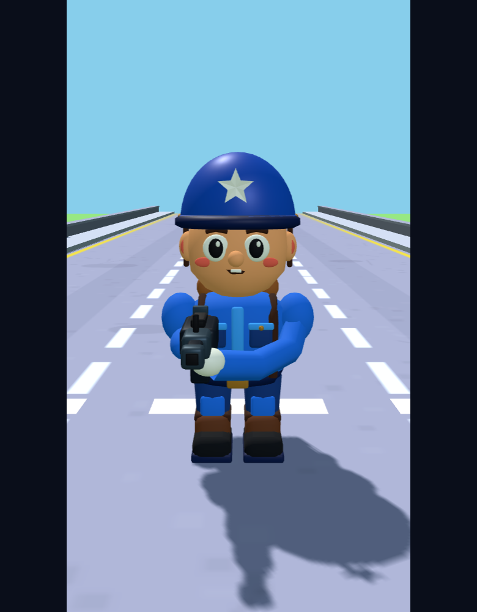
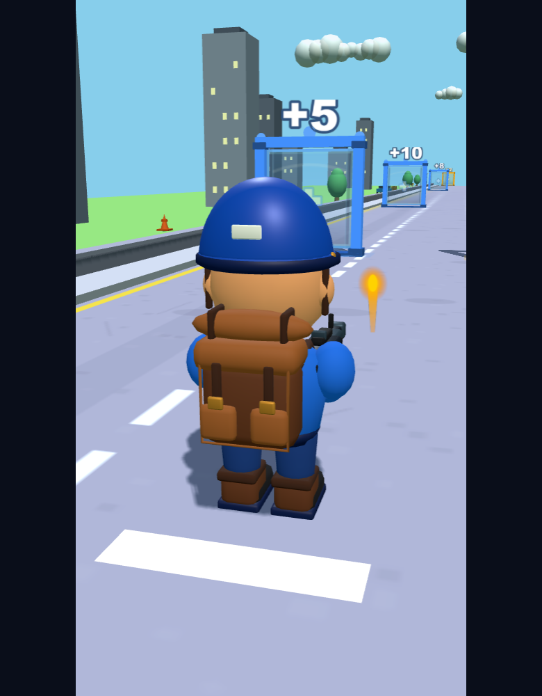
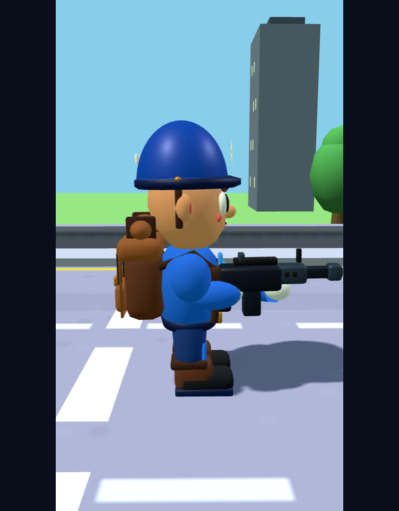

# V4.1 蓝色先锋兵：模型与美术交付

日期：2026-11-12。范围：只重建蓝色士兵，僵尸、Boss、道路和状态门未进入第二阶段。

## 实际资产

| 文件 | 内容 |
|---|---|
| `assets/models/soldier/soldier.glb` | 完整角色，12,454 三角形，334,428 字节 |
| `assets/models/soldier/soldier-lod.glb` | 军团低模，3,730 三角形，144,752 字节 |
| `assets/models/soldier/textures/soldier-basecolor.png` | 256×256 基础色图，sRGB |
| `assets/models/soldier/textures/soldier-orm.png` | 256×256 数据图，G=粗糙度，B=金属度，非颜色数据 |
| `tools/create-soldier.py` | 可复现的原创 Blender 建模与导出脚本 |
| `assets/models/soldier/model-stats.json` | 导出版本、三角形数、朝向和挂点数据 |

两份 GLB 均嵌入完整 PNG。外部 PNG 是编辑用源文件副本，游戏运行无需额外加载贴图路径。两份 GLB 合计约 468 KiB，GLB 加 PNG 副本约 519 KiB。

## 制作方法

环境最初没有 Blender；本轮从 Blender 官方站下载了便携版 **Blender 4.2.15 LTS**，放在仓库外 `D:/tools/blender-v41/`，实际运行后台 Python 导出。游戏端无需 Blender。重建命令见资产目录 README。

角色采用原创截面放样：有脸颊和下颌的头型、平滑穹顶与卷边帽檐、收腰制服。装备使用倒角面、皮带、口袋和接缝；枪有枪托、机匣、护木、弹匣、瞄具、制退器及深色枪口。眉毛、眼白、瞳孔、高光、鼻子、嘴和面颊均为真实表面。不是二维概念图、SVG、平面贴片或运行时堆叠球体。

背包包含翻盖、双口袋、绑带、金属扣和卷毯。双手握持枪械，靴子独立于裤腿。初版截图发现的暗蓝颜色、过硬高光、眉毛遮挡和左手悬空已修正；修复了 Blender 改变数据图颜色空间时清空像素的实际问题，并增加浏览器像素回归检查。

## 材质

共用一个 `MeshStandardMaterial` PBR atlas；每个活动部件一个 primitive。

| 区域 | 粗糙度 | 金属度 |
|---|---:|---:|
| 头盔漆面 | .44 | .12 |
| 制服 | .82 | 0 |
| 皮肤 | .72 | 0 |
| 背包皮革 | .78 | 0 |
| 枪身 | .40 | .55 |
| 枪械钢件 | .38 | .62 |
| 鞋底 | .92 | 0 |

保留原场景的历史 Lambert 颜色流程，为 GLB 材质单独增加 linear→sRGB 显示转换；衣服、皮肤和皮革不再呈现镜面塑料感。主场景前方补光从 .15 调整为 .30。

## 缩放、活动部件与动画

模型高 1.42 游戏单位，地面原点，Y 向上，-Z 向前。五个刚性部件为 Body、Head、Arms、LegL、LegR。背包合入 Body，武器及双手合入 Arms。Muzzle 是 Arms 的子挂点，静止世界位置 `(.16,.64,-.78)`。

Idle、Run、Shoot、Hit、Death、Victory 在实际游戏中采用程序化分部件动画。GLB **没有骨骼及内置动画剪辑**；动画实现、状态持续时间与过渡见集成报告。这符合本轮允许的程序化动画路线，但不等同于交付可直接用于其他引擎的骨骼动作库。

## 实际渲染

这些图来自实际 Game 的 Three.js 场景及渲染器，使用检视镜头；不是概念图。

## 验收边界

仓库与本轮上下文中未找到此前原始参考图，因此不能宣称已通过“与原参考基本一致”的最终人工验收。默认游戏镜头从后方跟随，主要展示头盔、背包、手臂和鞋子，正面脸部和星徽不会持续可见；正面细节以检视镜头截图证明。没有把此限制隐瞒为全部美术标准已通过，未扩展其他角色。

资产阶段提交：`b832431`、`1d64add`。最终交付提交见 `git log --oneline`，验证记录见 `V41_VISUAL_TEST.md`。
