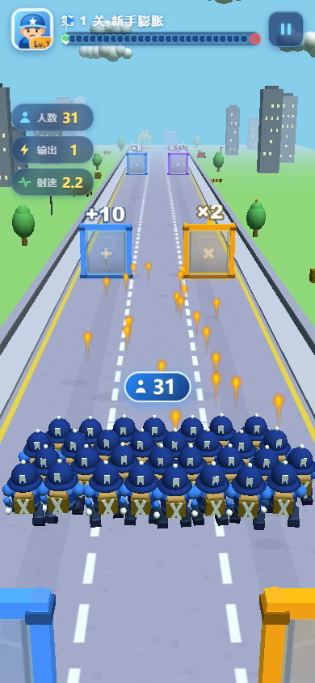
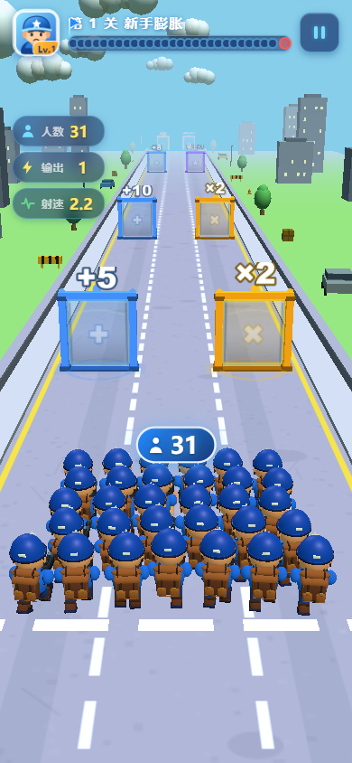
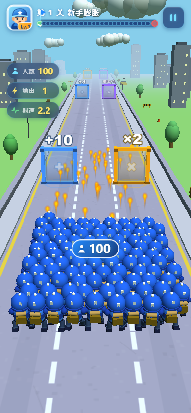
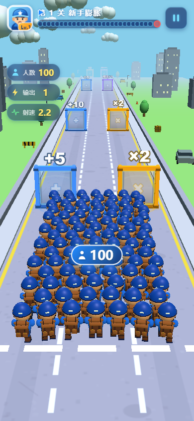

# V4.1 实际渲染与功能验收

日期：2026-11-12。实际渲染：系统 Edge + Three.js r149；图片来源是实际 H5 Game 的 scene/camera/renderer。

## 截图来源和复现

`node tools/v41-capture.js` 输出 `docs/screenshots/v41/`：四张单兵检视图、四种分辨率×六种人数，共24张正常跟随镜头图，以及一张未暂停的实时战斗图，合计29张。

固定随机种子410。军团图先推进180个固定步长使阵型和相机稳定，再设置跑步姿态；实际玩法未推进到随机战局。实时战斗图独立开始游戏并运行一秒，显示弹道及敌人。截图没有生成式补绘。

单兵图保持实际道路、灯光与游戏渲染器，暂停模拟并更换检视镜头、关闭雾、隐藏部分 HUD。镜头看向 `(0,.70,-.05)`：

| 图 | 镜头位置 |
|---|---|
| [正面](screenshots/v41/soldier-front.png) | `(0,1.23,-2.85)` |
| [背面](screenshots/v41/soldier-back.png) | `(.75,1.4,2.7)` |
| [侧面](screenshots/v41/soldier-side.png) | `(2.7,1.15,-.02)` |
| [射击](screenshots/v41/soldier-shoot.png) | `(1.7,1.4,-2.5)`，实际 Combat._fire 与后坐力 |

军团主图：[12人](screenshots/v41/390-squad-12.png)、[31人](screenshots/v41/390-squad-31.png)、[100人](screenshots/v41/390-squad-100.png)、[300人](screenshots/v41/390-squad-300.png)、[500人](screenshots/v41/390-squad-500.png)、[实时战斗](screenshots/v41/390-live-combat.png)。其他分辨率以 `360-`、`430-`、`1080-` 为前缀。

## 与旧版画面对比

| 仓库原有程序化角色历史截图 | 本轮 GLB 实际游戏截图 |
|---|---|
|  |  |
|  |  |

旧图为仓库自带 v4-final 历史素材，并非本轮对基线 SHA 重拍。新图中棕色双口袋背包、蓝衣、露出的手臂、双腿及靴子形成连续人形轮廓；31人改为平衡错列，100人增加纵深。前后图的镜头/时刻不同，不将它们作为逐像素回归基准。

**原始美术参考图未找到**。以上是旧版与新版的视觉对比，不能冒充对用户原始参考图的一致性验收。

## 美术检查结论

正面检视可辨白色五角星、眉眼、鼻子和嘴；侧面可辨枪托、弹匣、枪管和枪口；背面可辨包盖、绑带、双口袋与靴子。制服/皮肤/背包粗糙度与头盔/枪械区分明确。跑步左右腿反向、射击有实际后坐力，个体错相已通过实际网格矩阵检查。

默认跟随视角朝向士兵背面，正面星徽、脸与前向武器会有自然遮挡；100人及以上后排细节也因投影尺寸下降。**严格要求“默认镜头始终辨认脸、正面星徽、枪械”尚不能判定通过**，美术质量及与原参考的一致性仍需用户审看。不以自动测试通过替代最终美术验收，因此第二阶段未执行。

## 自动化验证

| 项目 | 结果 |
|---|---|
| 既有单元测试：存储、广告、移动、节奏 | 50通过 / 0失败 |
| GLB 二进制、嵌入PNG、PBR、UV、primitive/材质及三角形预算 | 通过 |
| 刚性动画运行时：实例组、兼容别名、枪口、受击、残影、胜利 | 通过 |
| 既有 Playwright E2E：移动、门、战斗、Boss、胜负、暂停、复活、500人 | 29通过 / 0失败 |
| 新士兵 Playwright E2E | 11通过 / 0失败 |
| H5 构建及 dist/h5 离线外网阻断启动测试 | 通过 |
| 4分辨率×6人数性能矩阵、10次增长/重置内存趋势 | 见性能报告及原始JSON |

11项专项覆盖加载失败可见重试且唯一 Game、真实 GLB 与贴图解码、ORM 像素非黑且颜色空间正确、缓存不重取、移动/人数门/射击、实际 Arms 矩阵枪口与子弹 xyz、六种状态与残影到期、100/101 LOD切换、各人数道路包络及相位差异、胜利存档跨页面刷新、浏览器运行无异常。

运行命令与结果以 `tools/v41-verify.js` 和 `docs/v41-verification.json` 为准。最终七组验证对应代码 SHA：`20ee0034016b56207805c2a7caf04bc2053e2867`，全部退出码为0；后续交付提交只增加报告和截图。本机 npm 不在 PATH，执行的是 package scripts 所指向的 Node 入口，不伪造 npm 命令成功记录。

## 剩余事项

原参考图人工对齐、默认镜头正面细节可读性、真机高 DPR/发热/长时间内存和原生小游戏加载适配尚未完成。没有重建僵尸/Boss，未宣称全部 V4.1 美术验收通过。
