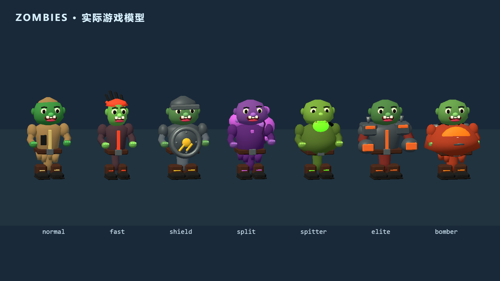
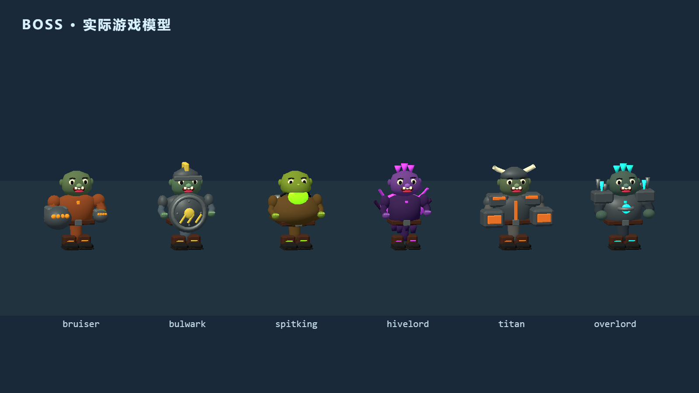

# V121 怪物与地图美术实装

2026-11-21。参考项目已安装的 create-game-assets、Three.js 模型加载与材质技能。
本轮修改实际模型、贴图和场景展示，保持原有玩法、数值、碰撞和相机。

## 已交付

- 7 类小怪：普通、快速、盾兵、分裂、喷吐、精英、爆炸。爆炸怪独立加载。
- 6 类 Boss：bruiser、bulwark、spitking、hivelord、titan、overlord。
- 26 个重新制作的 hero/LOD GLB，保留五部件程序动画、单 PBR 材质及内嵌贴图。
- 城市新增车辆、路障、沙袋；洞穴增加岩壁、石拱、蘑菇；机械区增加储罐、齿轮、管架；堡垒增加城墙、塔楼；感染区增加菌巢、晶体和根系。
- 一张 AI 生成并规范化的 1024×512 地图材质图集，八种材质实际映射至道路和场景网格。
- 五主题场景实例化、循环复用；非城市场景隐藏城市楼群，切回后恢复。

并非十关各一张独立地图：本轮为关卡已有的五种主题提供真实场景。枪械模型与完整攻击特效仍为后续工作。

## 游戏实截图

| 地图 | 改前 | 改后 |
|---|---|---|
| 城市 | [原版](art-v121-before/default-390x844.png) | [新版](art-v121-after/default-390x844.png) |
| 洞穴 | [原版](art-v121-before/cave-390x844.png) | [新版](art-v121-after/cave-390x844.png) |
| 机械 | [原版](art-v121-before/mechanical-390x844.png) | [新版](art-v121-after/mechanical-390x844.png) |
| 堡垒 | [原版](art-v121-before/fortress-390x844.png) | [新版](art-v121-after/fortress-390x844.png) |
| 感染区 | [原版](art-v121-before/apocalypse-390x844.png) | [新版](art-v121-after/apocalypse-390x844.png) |

截图由实际 Three.js 渲染器采集。战斗对照采用相同测试布置：12 人、七种怪物、关闭开火并清除门以展示模型；不是自然战斗流程。模型列队图使用实际 GLB、独立展示相机。改前通过 git c5a96a4 的原始脚本与模型复现。

## 验证

- 单元测试 102/102；26 个 GLB 的结构、法线、尺寸、LOD 和预算检查通过。
- 美术验收 5/5：独立爆炸怪、发光像素区域、移除装饰护栏与跨路横梁且保留选择门、五主题几何/材质/复用/恢复、浏览器无错误。
- 主流程 E2E 29/29；界面验证 7/7；微信模拟器 21/21，新增八材质随包加载与裁切检查。
- 门与增兵回归最终 11/11。首次随机路线测试因一波清怪超出 180 秒限制失败，完整重跑通过；本轮未修改任何战斗逻辑，该测试仍存在随机时限敏感性。
- H5、微信、抖音构建通过；H5 部署包启动及本地模型检查通过。
- 微信主包 2.81 MB、资源分包 2.89 MB、总包 5.70 MB；均在构建预算内。
- 所有 26 张模型纹理 256×256、地图材质 1024×512 的 asset_report 通过；已查看纹理联系表及实际游戏截图。

性能对照：同一桌面 Edge 无头浏览器、洞穴固定场景 100 士兵 +40 怪，预热60帧、采样120帧。
改前/改后约60/60 FPS，P95 均16.8ms，draw calls 120→102，三角形1493438→1491074；纹理24→38。
这是固定场景渲染对照，不代表手机真机战斗帧率。敌人 GLB 合计约3.38→2.33 MiB；地图图集约79.4 KiB。

## 制作与来源

怪物来自项目 Blender 脚本的原创程序化建模，无下载模型；每类目录保留 README 和统计。
地图图集来自 image_gen 的新生成素材，完整原图与提示词见 [来源记录](art-v121-source/README.md)。
复现脚本：`tools/create-enemies.py`、`tools/blender_art_common.py`、`tools/prepare-world-art-v121.py`。
生产资产清单见 [manifest](../../assets/art-v121/manifest.json)。原有用户士兵/头像改动未包含在本轮提交。

2026-11-23 追加：按用户截图要求清除道路护栏、装饰横梁及屋顶装饰条，保留人行道和关卡选择门。
