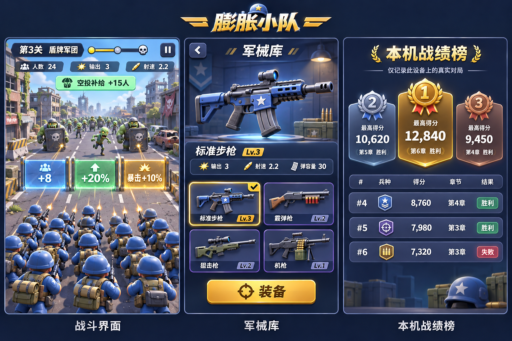
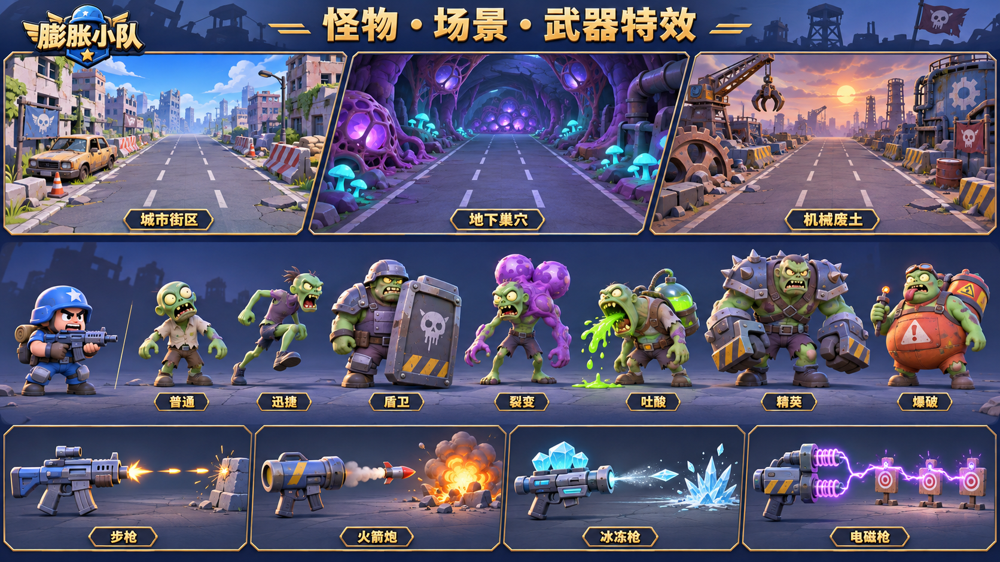

# 膨胀小队 · 视觉设计工作区

更新时间：2026-11-21。初稿参考 `3bb3570`，UI 交付已整合远端至 `25e1fae` 的 V12 更新。

用户最初要求视觉设计，随后确认效果图并明确要求直接修改游戏 UI。当前已获授权修改 HTML/CSS 与界面展示脚本，保留现有玩法和数值。随后用户要求实际重做怪物和地图，本轮已完成模型与五主题场景接入，见 [V121 美术实装](ART_V121.md)。

## 文档入口

- [视觉改版设计书](VISUAL_REDESIGN.md)：统一风格、各页面布局、怪物和场景设计、武器特效、资产交付与验收。
- [GameDev 技能库评估](GAMEDEV_SKILLS_ASSESSMENT.md)：哪些技能值得采用、安装建议、Three.js 版本差异与适用边界。
- [UI 实装与验证记录](IMPLEMENTATION_V118.md)：实际页面截图、通过的检查与现有测试限制。

## 已接入游戏的 UI

首页、战斗 HUD、军械库和本机战绩榜已应用深蓝金色主题。军械库接入八种透明插图，前三名来自实际本机战绩，保留真实切换、升级、解锁和记录逻辑。

- [首页实际截图](implemented-v118/home-390x844.png)
- [战斗实际截图](implemented-v118/battle-390x844.png)
- [军械库实际截图](implemented-v118/armory-390x844.png)
- [战绩榜实际截图](implemented-v118/rank-390x844.png)

截图由浏览器运行游戏后采集；军械库/榜单使用隔离浏览器中的测试存档验证状态，不写入玩家实际存档。下方两张原始概念图仍仅作为风格参考。

## 视觉效果图

### 界面总览：战斗、军械库、本机战绩榜

### 美术总览：地图、怪物、武器特效

以上为 image_gen 生成的第一版设计效果图，供确认风格和构图，不代表已接入游戏；示例数值不用于变更玩法。图中弹容量为生成稿附加示意，不作为新增功能。提示词与制作记录见 [生成说明](previews/GENERATION_NOTES.md)。

## 本轮交付状态

已交付：现有项目核对、设计方案、两张视觉效果图、核心 UI 实装、八种武器界面插图、实际页面截图、资产制作清单和技能库评估。

V121 已交付：七类小怪、六类 Boss 的真实 GLB 模型与 LOD，以及城市、洞穴、机械、堡垒、感染区五主题地图网格和生成材质，详见 [实装记录与游戏截图](ART_V121.md)。尚未交付：十关各自独立地图、战斗枪械模型和完整攻击特效资产。

## 工作边界

| 视觉设计负责 | 交给程序接入方 |
|---|---|
| 页面视觉稿、布局、配色、图标与界面 HTML/CSS/展示脚本 | 新的游戏机制、数据服务和非展示层逻辑 |
| 怪物和枪械设定、贴图、模型外观、资产清单 | 模型加载器、实例化渲染、武器挂点接入 |
| 地图概念、模块外观、天空与远景素材 | 地图生成、障碍/碰撞、相机和场景配置 |
| 特效外观、分镜、时长与层级标注 | 粒子系统、动画播放、性能降级和触发事件 |
| 排行榜页面及空状态等视觉稿 | 榜单计算、存档、联网、平台授权和数据上报 |

设计只表达现有游戏已经成立的规则。需要新增功能的想法单独标记为后续候选，不混入当前视觉验收。

## 开始制作时的顺序

1. 做一张 390×844 战斗关键视觉稿：同屏包含士兵、三种怪物、一排选择门、地图、弹道与 HUD。
2. 按真实手机显示尺寸确认角色和门能读清，再制作首页、军械库、排行榜页面稿。
3. 通过同一视觉目标派生怪物、武器和地图资产，逐批验收，避免每批风格漂移。
4. 输出资产及标注交给程序接入方；接入后的截图和性能检查由接入方提供，再进行视觉复核。

当前保留项目已有的卡通 3D 方向。本文档不授权改伤害、血量、出怪、选门、排行榜评分或安装全局技能，也不覆盖已有未提交的模型和头像文件。
